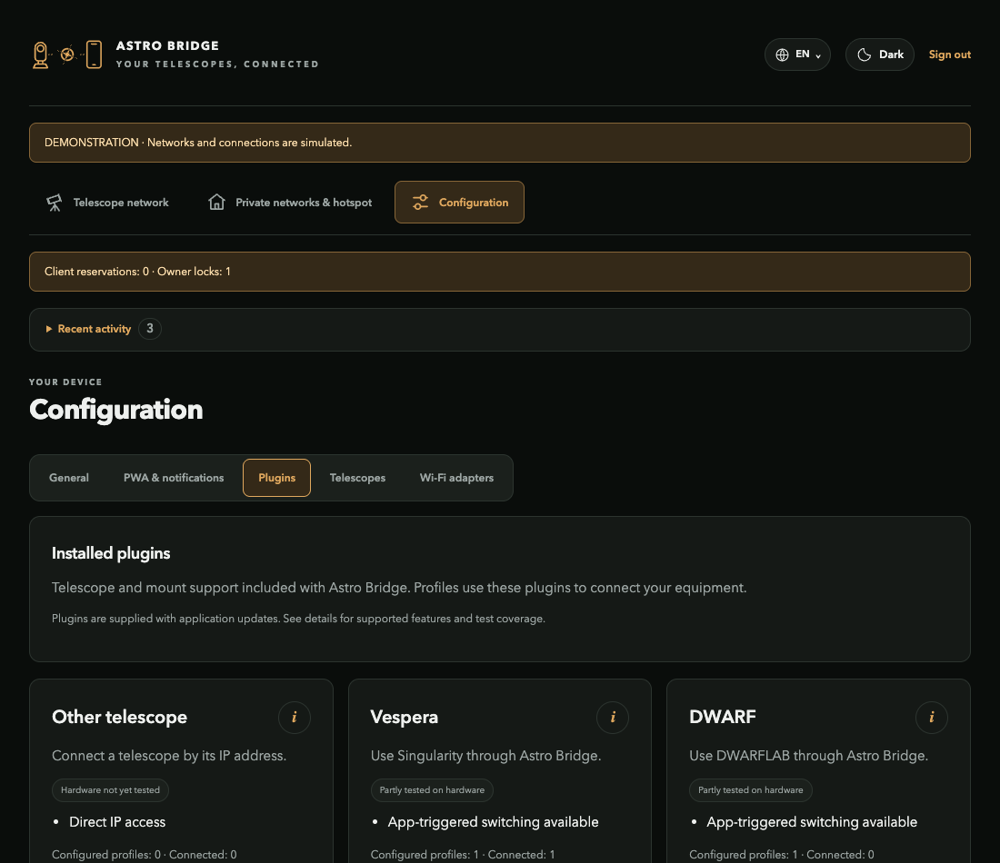

# Astro Bridge Core

**Your telescope apps. One connected observing setup.**

[](https://github.com/Sqound/astro-bridge-core/actions/workflows/checks.yml)
[](LICENSE)
[](pyproject.toml)

Astro Bridge connects a phone or tablet to smart telescopes and Wi-Fi mounts through a Linux host. Keep using the manufacturer's app, switch between saved instruments, and choose whether your phone stays on home Wi-Fi or joins the Astro Bridge hotspot.


*Actual application in demonstration mode. All networks and devices shown are synthetic.*

## What it does

- **Connect equipment:** scan nearby Wi-Fi, recognize a supported family, and add a prefilled profile.
- **Switch when an app searches:** use a free compatible adapter, or replace an eligible inactive connection after its release delay.
- **Keep an instrument connected:** viewing activity, reservations and owner locks prevent unwanted automatic replacement.
- **Choose your network:** private Wi-Fi bridge, isolated hotspot, or hotspot with Internet through the saved private Wi-Fi.
- **Install the web app:** trusted local HTTPS, home-screen installation and optional Web Push notifications.
- **Extend hardware support:** versioned JSON plugins select reviewed transports, discovery and identification adapters.

Astro Bridge relays connections. It does not replace the telescope app or run an acquisition scheduler.

## Try the demo

```sh
git clone https://github.com/Sqound/astro-bridge-core.git
cd astro-bridge-core
python3 -m wifi_bridge --demo
```

Open **http://127.0.0.1:8787** and sign in with **`demo-telescope-2026`**. Python 3.11+ on a Unix system is sufficient. Demo mode uses simulated adapters and never changes your host's network.

For a release install, download the wheel and `SHA256SUMS` from [Releases](https://github.com/Sqound/astro-bridge-core/releases). The [installation guide](doc/getting-started.md) explains checksum verification and isolated installation.

## Deploy on hardware

| You have | Start here |
| --- | --- |
| Raspberry Pi Zero W | [Raspberry appliance](https://github.com/Sqound/astro-bridge-implementations/blob/main/doc/raspberry.md) |
| A dedicated Linux machine | [Native Linux](https://github.com/Sqound/astro-bridge-implementations/blob/main/doc/linux.md) |
| Docker on Linux | [Docker networking](https://github.com/Sqound/astro-bridge-implementations/blob/main/doc/docker.md) |
| Docker Desktop on Windows/macOS | [Docker demo](https://github.com/Sqound/astro-bridge-implementations/blob/main/doc/docker.md#try-the-demo) |

Real networking needs suitable Linux Wi-Fi adapters and host integration. Plan one adapter per simultaneous Wi-Fi role; a private uplink, hotspot and telescope uplink normally need three adapters. Docker Desktop does not expose physical Wi-Fi management to this application.

## Equipment catalog

| Family | App connection | Current evidence |
| --- | --- | --- |
| Seestar | Active discovery and native TCP relays | S50 Pro app, preview and switching checked |
| Vespera | Routed original address; TCP connection demand | Vespera 2 connection and switching checked |
| DWARF | Native TCP relays; passive app-search demand | DWARF mini control/preview checked; initial IP entry may be needed |
| ZWO Wi-Fi mounts | TCP 4030; read-only model identification | AM5N association, identity and relay checked; guiding pending |
| SynScan Wi-Fi mounts | UDP 11880; scoped version search | Isolated protocol/network tests; physical hardware pending |
| Generic equipment | Manually configured routed access | Protocol-specific validation required |

A matching Wi-Fi name is a hint, not proof of compatibility. See [connection mechanisms and limits](doc/reference/discovery.md). Instruments using the same downstream subnet must be selected one at a time.

## Explore the interface

| Network modes | Hardware plugins |
| --- | --- |
|  |  |

## Documentation

Start at the [documentation index](doc/README.md).

| Task | Guide |
| --- | --- |
| Add a telescope or mount | [Scan and add equipment](doc/guides/add-equipment.md) |
| Choose Wi-Fi/hotspot behavior | [Network modes](doc/guides/network-modes.md) |
| Understand automatic switching | [Switching and protection](doc/guides/switching.md) |
| Enable iOS notifications | [PWA and notifications](doc/guides/pwa-notifications.md) |
| Add support for hardware | [Declarative plugin tutorial](doc/plugins/README.md) |
| Integrate another client | [Local API](doc/reference/api.md) |

## Contribute

See [CONTRIBUTING.md](CONTRIBUTING.md). Hardware pull requests should include a protocol reference, sanitized fixtures, generated catalog changes and an explicit test matrix. A new protocol requires a reviewed adapter; a manifest cannot execute arbitrary code.

```sh
python3 -m unittest discover -s tests
node --test tests/*.test.mjs
python3 tools/build-plugins.py --check
python3 tools/build-i18n.py --check
python3 tools/build-release.py
```

The application and platform repositories have a one-way dependency: implementations consume an exact core release, pinned by SHA-256. This repository contains no board image or hardware credentials.

## License

**Astro Bridge code and documentation are licensed under the [MIT License](LICENSE).** Copyright belongs to Astro Bridge contributors. Optional dependencies and operating-system components retain their own licenses; see [THIRD_PARTY_NOTICES.md](THIRD_PARTY_NOTICES.md).

Manufacturer names identify compatible protocols and products. Astro Bridge is an independent project.
