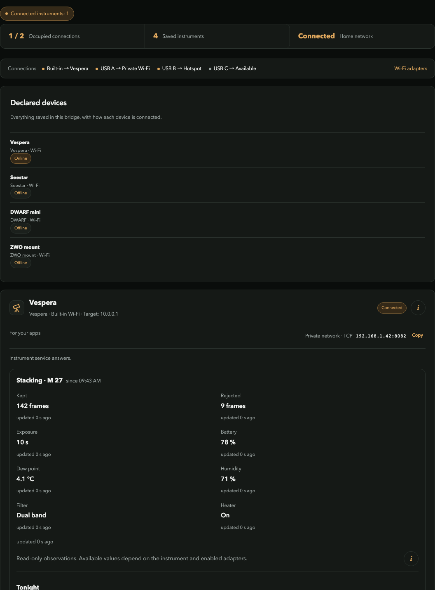
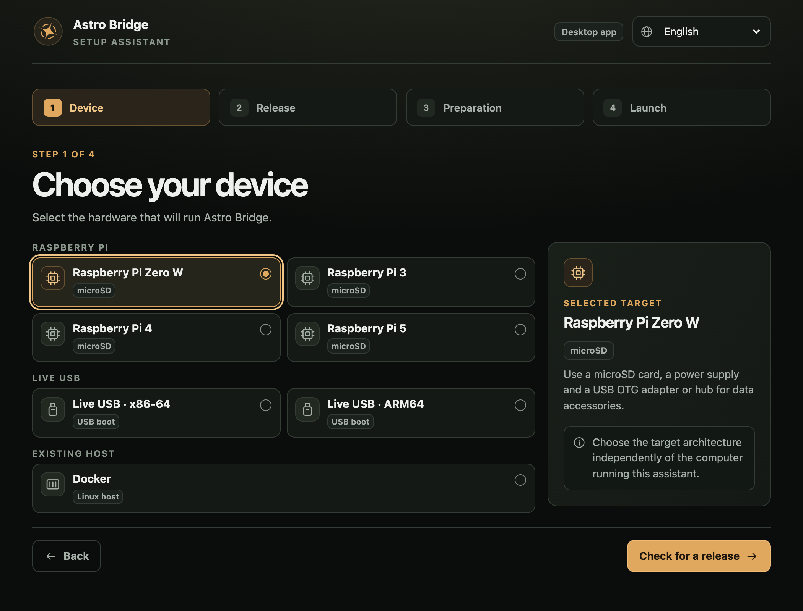
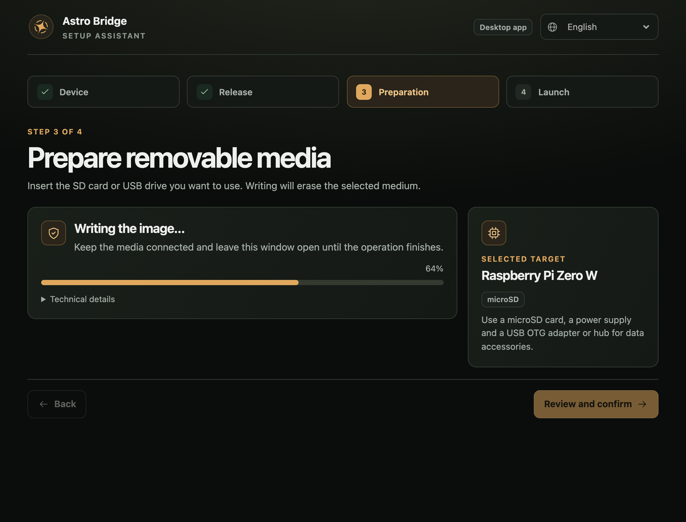
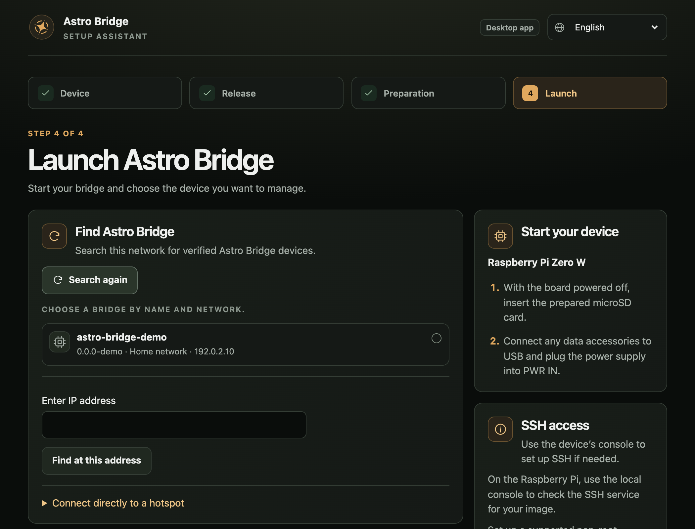
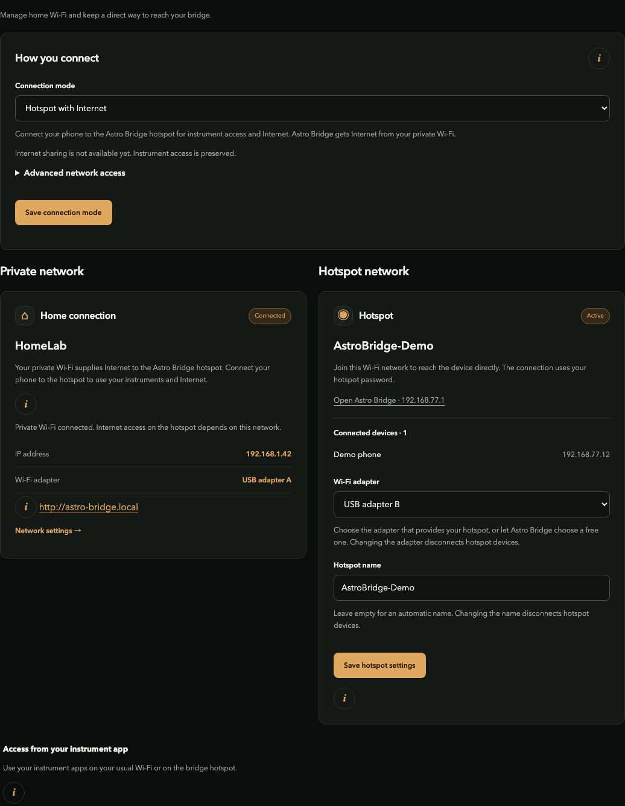
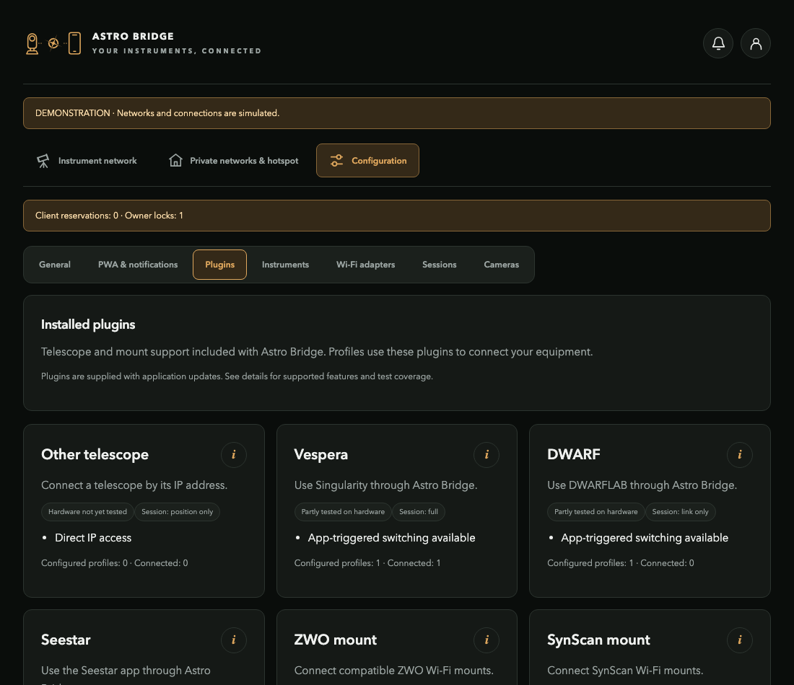

# Astro Bridge Core

**Your telescope apps. One connected observing setup.**

Astro Bridge Core is part of [PlanAstro](https://www.planastro.space/), a complete astrophotography solution: plan your night, drive your telescope and mount from your smartphone, assisted by its own plate solving, then process and share your images.

[](https://github.com/Sqound/astro-bridge-core/actions/workflows/checks.yml)
[](LICENSE)
[](pyproject.toml)

Astro Bridge connects a phone or tablet to smart telescopes and Wi-Fi mounts through a Linux host. Keep using the manufacturer's app, switch between saved instruments, and choose whether your phone stays on home Wi-Fi or joins the Astro Bridge hotspot.



*Actual application in demonstration mode. All networks and devices shown are synthetic.*

## What it does

- **Connect equipment:** scan nearby Wi-Fi, recognize a supported family, and add a prefilled profile.
- **Switch when an app searches:** use a free compatible adapter, or replace an eligible inactive connection after its release delay.
- **Keep an instrument connected:** viewing activity, reservations and owner locks prevent unwanted automatic replacement.
- **Choose your network:** private Wi-Fi bridge, isolated hotspot, or hotspot with Internet through the saved private Wi-Fi.
- **Install the web app:** trusted local HTTPS, home-screen installation and optional Web Push notifications.
- **Extend hardware support:** versioned JSON plugins select reviewed transports, discovery and identification adapters.

Astro Bridge relays connections. It does not replace the telescope app or run an acquisition scheduler.

## Choose how to run Astro Bridge

| Option | What it includes |
| --- | --- |
| **Complete Raspberry Pi image** | Alpine Linux and Astro Bridge, preconfigured to start as a system service at boot; flash an SD card for the original Pi Zero W |
| **Core only — this repository** | The application, web interface, API and equipment plugins; install on an existing system and add Linux host integration for real Wi-Fi control |
| **Docker** | Core and its container dependencies; demonstration mode on macOS/Windows, or real networking on a compatible Linux host |

The Core download is the application, not a complete operating-system image. See [installation options](https://github.com/Sqound/astro-bridge-implementations/blob/main/doc/deployment-options.md) to choose the right package.

## Try the demo

```sh
git clone https://github.com/Sqound/astro-bridge-core.git
cd astro-bridge-core
python3 -m wifi_bridge --demo
```

Open **http://127.0.0.1:8787** and sign in with **`12345678`**. Python 3.11+ on a Unix system is sufficient. Demo mode uses simulated adapters and never changes your host's network.

For a release install, download `install.py` from [Releases](https://github.com/Sqound/astro-bridge-core/releases). It downloads the pinned wheel, verifies its checksum and installs it in an isolated environment without sudo. See the [installation guide](doc/getting-started.md).

New Raspberry, native Linux and Docker installations use **`12345678`** for web access and the hotspot. Demo mode uses the same initial password. Existing installations retain their saved passwords during upgrades.

## Deploy on hardware

| You have | Start here |
| --- | --- |
| Raspberry Pi Zero W or Pi 5 (with Astro Bridge Setup) | [Raspberry appliance](https://github.com/Sqound/astro-bridge-implementations/blob/main/doc/raspberry.md) |
| A dedicated Linux machine | [Native Linux](https://github.com/Sqound/astro-bridge-implementations/blob/main/doc/linux.md) |
| Docker on Linux | [Docker networking](https://github.com/Sqound/astro-bridge-implementations/blob/main/doc/docker.md) |
| Docker Desktop on Windows/macOS | [Docker demo](https://github.com/Sqound/astro-bridge-implementations/blob/main/doc/docker.md#try-the-demo) |

Real networking needs suitable Linux Wi-Fi adapters and host integration. Plan one adapter per simultaneous Wi-Fi role; a private uplink, hotspot and telescope uplink normally need three adapters. Standard Docker Desktop setups do not expose physical Wi-Fi radios to the application. USB forwarding and Linux host integration would require additional setup and hardware validation.

## Equipment and evidence

| Family | Implemented | Tested in simulation | Verified on hardware |
| --- | --- | --- | --- |
| Raspberry Pi 5 host, hotspot, two USB Wi-Fi adapters | Yes (image in implementations 1.2.0) | Yes | **Yes, partly:** with release candidates of 1.2.0, the hotspot and the web page at every boot, the home Wi-Fi, a mount linked at boot on the second adapter, the offline fallback hotspot started, cable and Wi-Fi on one network, the SSH key kept across boots, a restart in a few seconds and logs kept across a power cut. Earlier: automatic adapter roles in under 6 s, IPv4 forwarding, hotspot DHCP, DNS and Internet. USB Wi-Fi adapters plugged side by side against the board linked less reliably than on an extension cable |
| Raspberry Pi Zero W host | Yes (image in implementations 1.2.0) | Yes | **Partly:** 600 s idle run and a TCP relay test (147/147 replies). Camera hosting is not supported on this board. A full telescope session, hotspot loss/recovery and phone discovery are not yet checked |
| Raspberry Pi 3 B, Pi 4 | Yes | Yes | No |
| Vespera (Wi-Fi, routed original address) | Yes | Yes | **Partly:** switching and the manufacturer-app path. Two isolated Vespera, per-tab switching and night reservation: no |
| Seestar (relays, station profile) | Yes | Yes | **Partly:** automatic switching to and from another telescope (about 40 s) with notifications. Bridge `scan_iscope` probe and station mode: no |
| DWARF (relays, operation state) | Yes | Yes | **Partly:** manufacturer-app discovery observed. Operation-state reading during a capture: no |
| ZWO Wi-Fi mounts (TCP 4030) | Yes (read-only identification, relay, protection) | Yes | **Partly:** model read through the relay. Control, guiding, automatic switching: no |
| SynScan Wi-Fi mounts (UDP 11880) | Yes | Yes | **Partly:** AZ-GTiX linked without any action at boot, with its own address, the PlanAstro app linked through the bridge for three hours (one Wi-Fi drop, back by itself in about 11 s), and the relay alone cut for 10 s three times without losing the mount Wi-Fi. Other models: no |
| Celestron NexStar over USB serial (TCP relay) | Yes | Pseudo-terminal tests | No |
| USB cameras over Alpaca (ZWO ASI) | Yes | Yes | **Partly:** ASI220MM Mini with the SDK 1.42 downloaded on request: driver installed from Setup and from the web interface, 1920 × 1080 16-bit image received through Alpaca, gain applied. Earlier, through a hub: full frame failed with USB resets |
| USB cameras (UVC, gPhoto) | Yes | Yes | No |
| Native client contract 1.2 (pairing, leases, events, telemetry) | Yes | Replay scenarios and loopback mock | No third-party client verified against a physical bridge |
| Astro Bridge Setup 1.2.0 (macOS, Windows, Linux) | Yes | Unit, Rust and browser tests with mocks | **Partly (macOS):** cards written for the Pi 5 with the home Wi-Fi, a bridge password and the ZWO driver, Launch found the bridge on the home network, a mount added and connected from Launch. Windows and Linux builds not checked on a computer |
| Docker demo | Yes | Yes | Demo verified in a Linux VM on macOS. Physical USB Wi-Fi inside Docker: no |

**Documented is not verified.** Only the last column is hardware evidence, and "partly" lists exactly what was observed. A matching Wi-Fi name is a hint, not proof of compatibility. Live USB images and Celestron Origin are not part of this release. A freshly written 1.2.0 Pi Zero W image still needs its first-boot check.

See [connection mechanisms and limits](doc/reference/discovery.md). Instruments using the same downstream subnet must be selected one at a time.

## Astro Bridge Setup

Astro Bridge Setup is a desktop assistant that downloads a published Astro Bridge image or installer, verifies its SHA-256, writes and reads back the SD card after an explicit erase confirmation, then finds the running bridge on your network and opens its web interface.

| Choose the device | Write the card | Find the bridge |
| --- | --- | --- |
|  |  |  |

Setup is part of the deployment recipes and shares their version. Download it from the [implementations release](https://github.com/Sqound/astro-bridge-implementations/releases/latest) and read the [step-by-step guide](https://github.com/Sqound/astro-bridge-implementations/blob/main/setup/README.md). *Screens use a synthetic backend; names and checksums are demonstration values.*

## Explore the interface

| Network modes | Hardware plugins |
| --- | --- |
|  |  |

## Documentation

Start at the [documentation index](doc/README.md).

| Task | Guide |
| --- | --- |
| Add a telescope or mount | [Scan and add equipment](doc/guides/add-equipment.md) |
| Choose Wi-Fi/hotspot behavior | [Network modes](doc/guides/network-modes.md) |
| Understand automatic switching | [Switching and protection](doc/guides/switching.md) |
| Enable iOS notifications | [PWA and notifications](doc/guides/pwa-notifications.md) |
| Add support for hardware | [Declarative plugin tutorial](doc/plugins/README.md) |
| Integrate another client | [Local API](doc/reference/api.md) |

## Contribute

See [CONTRIBUTING.md](CONTRIBUTING.md). Hardware pull requests should include a protocol reference, sanitized fixtures, generated catalog changes and an explicit test matrix. A new protocol requires a reviewed adapter; a manifest cannot execute arbitrary code.

```sh
python3 -m unittest discover -s tests
node --test tests/*.test.mjs
python3 tools/build-plugins.py --check
python3 tools/build-i18n.py --check
python3 tools/build-release.py
```

The application and platform repositories have a one-way dependency: implementations consume an exact core release, pinned by SHA-256. This repository contains no board image or hardware credentials.

## License

**Astro Bridge code and documentation are licensed under the [MIT License](LICENSE).** Copyright belongs to Astro Bridge contributors. Optional dependencies and operating-system components retain their own licenses; see [THIRD_PARTY_NOTICES.md](THIRD_PARTY_NOTICES.md).

Manufacturer names identify compatible protocols and products. Astro Bridge is an independent project.
