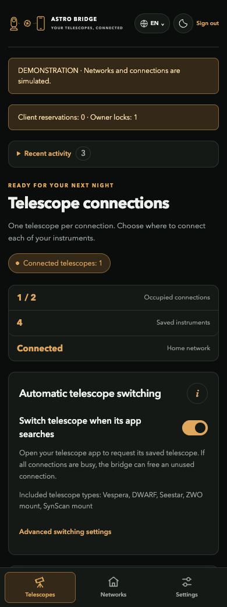

# Astro Bridge documentation

Use the manufacturer's telescope app while Astro Bridge manages the network connection.

*Demonstration interface with synthetic equipment and networks.*

Compare the [complete Raspberry Pi image, Core application and Docker](https://github.com/Sqound/astro-bridge-implementations/blob/main/doc/deployment-options.md) before installing.

## Start here

1. [Install or try the application](getting-started.md).
2. [Choose a network mode](guides/network-modes.md).
3. [Scan and add equipment](guides/add-equipment.md).
4. [Connect from the manufacturer's app](reference/discovery.md).

## Use Astro Bridge

| Guide | What it explains |
| --- | --- |
| [Switching and protection](guides/switching.md) | App searches, release delay, activity, locks and reservations |
| [PWA and notifications](guides/pwa-notifications.md) | HTTPS trust, iOS installation and notification behavior |
| [Mount connections](guides/mounts.md) | ZWO and SynScan endpoints, discovery and test scope |
| [Troubleshooting](guides/troubleshooting.md) | Common symptoms and targeted checks |

## Extend and integrate

- [Create a declarative hardware plugin](plugins/README.md)
- [Manifest field reference](plugins/manifest-reference.md)
- [Validate and submit hardware support](contributing/hardware-validation.md)
- [Connection architecture](reference/architecture.md)
- [Discovery mechanisms](reference/discovery.md)
- [Authenticated local API](reference/api.md)
- [Validation scope](reference/validation.md)

Deployment instructions live in [Astro Bridge Implementations](https://github.com/Sqound/astro-bridge-implementations/tree/main/doc). Screenshots show the actual demo interface, not physical hardware acceptance.
