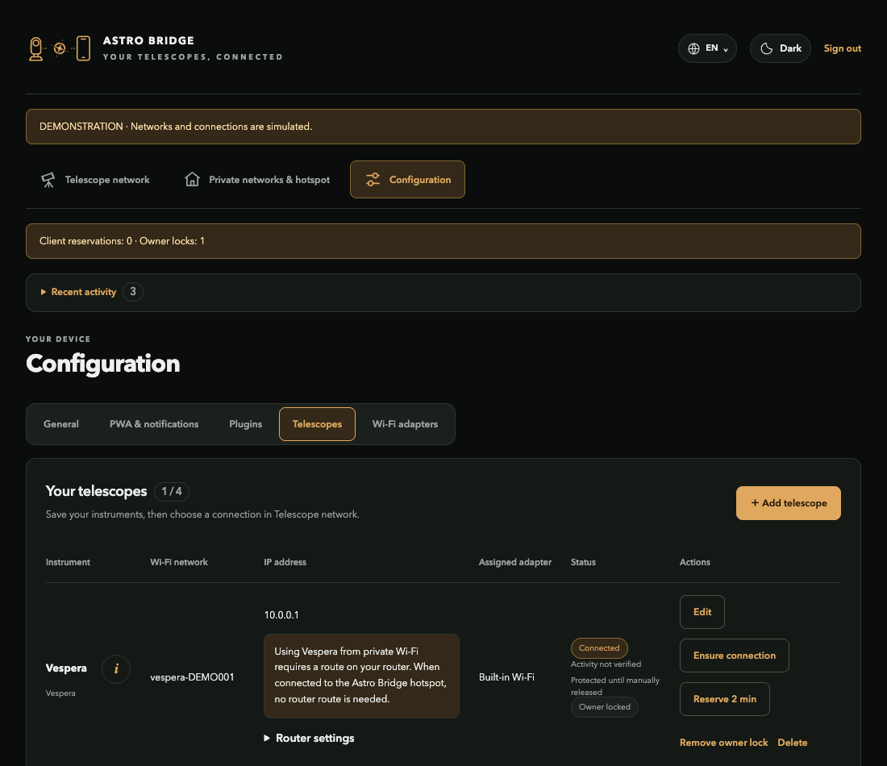

# Get started

[Documentation](README.md) / Get started

## Choose an installation

| Goal | Install |
| --- | --- |
| Explore without hardware | Run the demo below |
| Use a Raspberry Pi Zero W | [Raspberry implementation](https://github.com/Sqound/astro-bridge-implementations/blob/main/doc/raspberry.md) |
| Use a Linux PC | [Native Linux or Docker](https://github.com/Sqound/astro-bridge-implementations/tree/main/doc) |

## Run the demo

```sh
python3 -m wifi_bridge --demo --demo-radios 4
```

Open **http://127.0.0.1:8787**. Password: **`demo-telescope-2026`**. Configuration is stored in `.runtime/`; no real radios or telescope commands are used.



## Install a verified release

The release includes a small standalone installer. On Linux, install Python 3.11+ and its venv support first (Debian/Ubuntu: `sudo apt install python3 python3-venv curl`). Then:

```sh
curl -fLO https://github.com/Sqound/astro-bridge-core/releases/download/v1.0.1/install.py
python3 install.py
"$HOME/.local/share/astro-bridge-1.0.1/bin/astro-bridge" --demo \
  --state-dir "$HOME/.local/state/astro-bridge-demo"
```

The versioned installer downloads the exact wheel, verifies its embedded SHA-256, and creates a separate environment in your home directory. It needs no sudo, does not change system Python, and refuses to overwrite an existing installation. Download and inspect it before running if desired. The complete MIT notice is included.

For an offline install, download the wheel and `SHA256SUMS` from [the same release](https://github.com/Sqound/astro-bridge-core/releases/tag/v1.0.1):

```sh
sha256sum --ignore-missing -c SHA256SUMS
python3 install.py --wheel astro_bridge_core-1.0.1-py3-none-any.whl \
  --sha256 THE_VERIFIED_WHEEL_SHA256 --prefix "$HOME/.local/share/astro-bridge-1.0.1"
```

Core installation alone provides the application/demo. Physical radio management is Linux-only and needs the [Linux/Docker deployment](https://github.com/Sqound/astro-bridge-implementations/tree/main/doc), which owns NetworkManager, host services, privileges and drivers. Demo mode can also run on macOS or Docker Desktop; native Windows Wi-Fi control is unsupported.

## Connect physical equipment

1. Open Astro Bridge through its configured private-network address or **192.168.77.1** on its hotspot.
2. Sign in with the implementation's initial access code and change it in **Settings**.
3. Choose [Network mode](guides/network-modes.md).
4. [Add equipment](guides/add-equipment.md), then select **Connect**.
5. Open the manufacturer's app using the connection path described for that family.

Keep a working management connection while changing adapter assignments.
