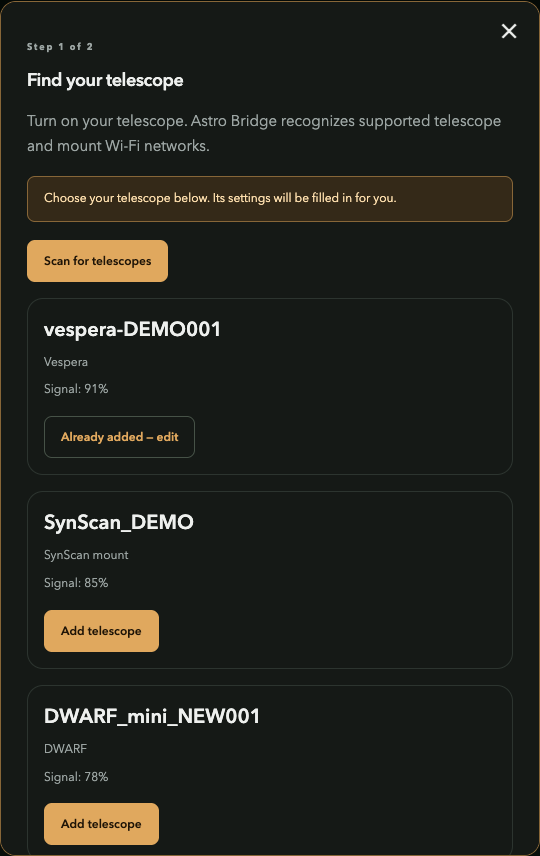
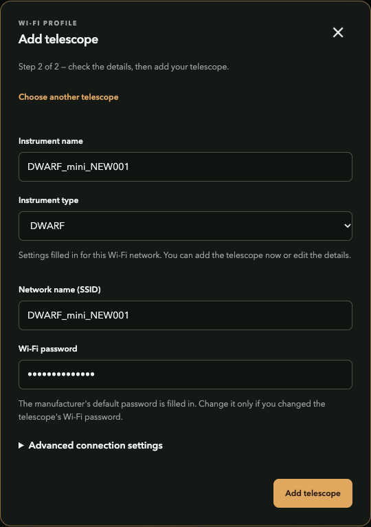

# Scan and add equipment

[Documentation](../README.md) / Add equipment

## 1. Find the device

Power on the instrument. In **Settings → Telescopes**, choose **Add telescope** and scan.

A Wi-Fi prefix selects a likely plugin family. It does not authenticate the device. If no compatible family appears, use manual entry or [contribute a plugin](../plugins/README.md).

When no telescope is selected or connected, an idle unreserved adapter can scan periodically. Fresh, recognized, unsaved devices appear on the home page. A new-device notification opens the retained observation's prefilled form after authentication.

## 2. Review and save

Select **Add** beside a result. Review the suggested name, family, address and documented factory defaults.

- Enter the actual Wi-Fi password if the factory value is unknown or has changed.
- Save the profile. Saving does not connect or move a device.
- Select **Connect** on the home page; then open the manufacturer's app.

Advanced fields include adapter selection, target IP and physical Wi-Fi binding. A saved profile identifies one device; a plugin describes its protocol family.

## When every adapter is occupied

| Scan path | Behavior |
| --- | --- |
| Idle spare adapter | Active Wi-Fi scan |
| Connected compatible station | A manual scan may use that station's supported scan path |
| Hotspot, protected or unavailable adapter | Not borrowed for an automatic scan |
| No safe scan path | Cached observations or a visible reason; manual entry remains available |

The scan's status appears at the top of the assistant. A stale observation can expire; scan again rather than treating an old SSID as a currently available device.
