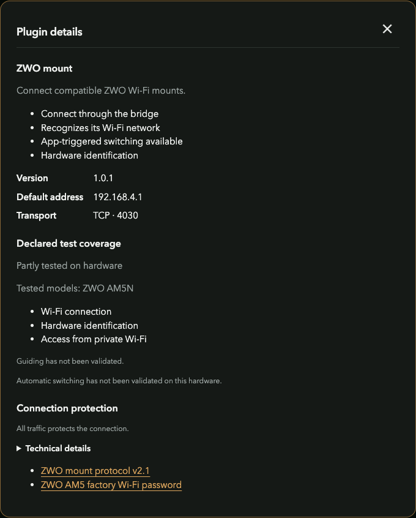

# ZWO and SynScan Wi-Fi mounts

[Documentation](../README.md) / Mounts

## Connection paths

| Family | Wi-Fi hint | Native relay | Read-only identification | Evidence |
| --- | --- | --- | --- | --- |
| ZWO AM-series | `AMH_…` | TCP 4030 on the bridge address | Model query `:GVP#` with a bounded reply | AM5N Wi-Fi, model and relay checked; guiding pending |
| SynScan Wi-Fi | `SynScan_…` | UDP 11880 on the bridge address | Axis version query `:e1\r` | Packet/namespace tests; physical hardware pending |

On the hotspot, use **192.168.77.1** as the app's bridge endpoint. On private Wi-Fi, use the displayed private-network bridge address. Direct access to the mount's original subnet can still need a router route.

## ZWO

A compatible initial TCP connection to the bridge proxy can request selection of an eligible saved mount. A Wi-Fi prefix/model match does not establish guiding compatibility for every ZWO model. Validate the specific mount, firmware and controlling app.

## SynScan

The adapter recognizes a scoped version search, selects eligible saved equipment, and relays the supported request/reply exchange. Replies must match the expected axis, sender/interface and format. Unselected devices do not receive arbitrary broadcast commands.

UDP **11880 is a protocol transport**, not an unsolicited beacon. If automatic search is unavailable in a client, select its fixed-IP connection mode and enter the bridge address.

Both families use conservative all-traffic activity protection. These mounts commonly share **192.168.4.0/24**; select them sequentially under the current routing model.
