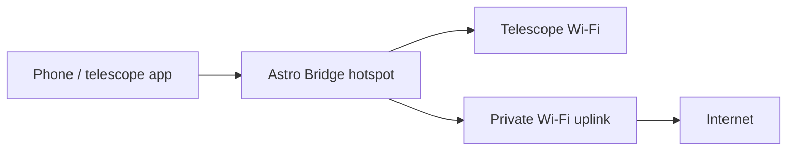

# Network modes

[Documentation](../README.md) / Network modes

Choose the mode in **Networks**, then save it.

| Mode | Phone joins | Internet | Router route for the telescope |
| --- | --- | --- | --- |
| Private Wi-Fi bridge | Your usual Wi-Fi | Through that network | Sometimes, especially Vespera |
| Isolated hotspot | Astro Bridge hotspot | Not provided by the hotspot | Not needed for hotspot clients |
| Hotspot with Internet | Astro Bridge hotspot | Shared from the saved private Wi-Fi | Not needed for hotspot clients |

## Hotspot with Internet

The private Wi-Fi supplies Internet to Astro Bridge; connect the phone to the **hotspot**. Internet sharing becomes ready only with a usable uplink. A lost uplink does not need to remove the hotspot's telescope access.

Access from hotspot clients to other private-LAN devices is a separate advanced permission. Enabling Internet sharing does not automatically open the reverse private-LAN-to-hotspot direction.

## Private Wi-Fi and Vespera

Vespera uses its original **10.0.0.1** address. On private Wi-Fi, configure the router to route **10.0.0.0/24 through Astro Bridge's private-network IP**. The equipment connection details show the actual values.

Example: if Astro Bridge is **192.168.1.42**, the route is:

| Destination | Mask | Gateway |
| --- | --- | --- |
| 10.0.0.0 | 255.255.255.0 | 192.168.1.42 |

On the Astro Bridge hotspot, DHCP supplies the relevant device routes. Rejoin the hotspot if a phone has an old DHCP lease.

## Adapter planning

Plan one adapter per active Wi-Fi role: private uplink, hotspot and each connected downstream network. Three simultaneous roles normally need three adapters. Only compatible, unreserved adapters can be assigned.

Devices sharing a downstream subnet must be used one at a time. Native proxy ports also have one active owner. Ethernet management is outside the current web configuration; the Internet-sharing uplink selector configures private **Wi-Fi**.
