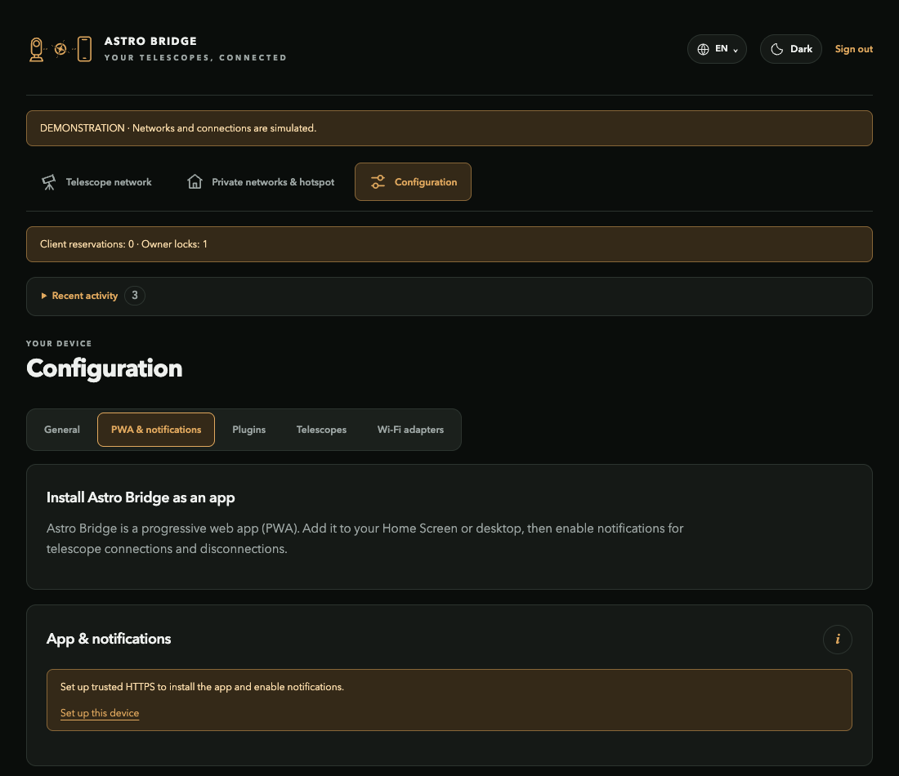
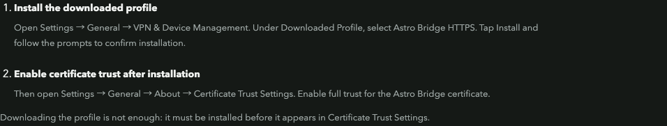

# Install the PWA and enable notifications

[Documentation](../README.md) / PWA and notifications

Astro Bridge is a progressive web app: install it on your home screen and optionally receive connection, switching and system notifications.

## Set up iPhone or iPad

1. Open **Settings → PWA & notifications → Set up this device**. Choose **iPhone / iPad**.
2. Follow **Secure local access** to create the device certificate. Use a correct bridge date/time.
3. Download the iOS certificate profile in Safari and allow the download.
4. Open iOS **Settings → General → VPN & Device Management**. Select **Astro Bridge HTTPS**, tap **Install**, and confirm installation.
5. Open **Settings → General → About → Certificate Trust Settings**. Enable full trust for the Astro Bridge certificate.
6. Open the displayed **HTTPS** address without a certificate warning and sign in.
7. In Safari, choose **Share → Add to Home Screen**. Launch the new icon.
8. Choose **Enable notifications** and accept the iOS permission prompt.

Downloading a profile does not install or trust it. Complete both iOS settings steps. Use the same HTTPS address for the installed app and its notification subscription.

*The iOS procedure is shown with synthetic certificate status in the demo UI.*

## Useful notifications

| Category | Examples |
| --- | --- |
| Discovery | Recognized unsaved telescope; opens the prefilled addition flow |
| Connections | Instrument connected, disconnected or needs attention |
| Switching | Switch started, estimated duration and completion/failure |
| Hotspot | A client joined the hotspot |
| Network mode | Connection mode changed |
| Updates | Available or installed application version |
| Startup | Bridge started, hotspot name and mode |

New subscriptions enable the available categories by default. Existing choices are retained through updates. Tapping a supported notification opens the relevant application page; authentication is still required.

## Delivery requirements

- iOS Web Push requires a home-screen web app and a supported iOS version (16.4+).
- The bridge needs Internet to send to the push provider; the phone needs Internet to receive.
- An isolated hotspot alone does not supply Internet.
- Device permissions, Focus settings and provider scheduling affect delivery. Provider acceptance does not prove a visible notification.

Signing out stops notifications on all registered devices. Certificate/key resets can require renewed trust and subscription setup. See the in-app procedure for Android, macOS, Windows and Linux.
