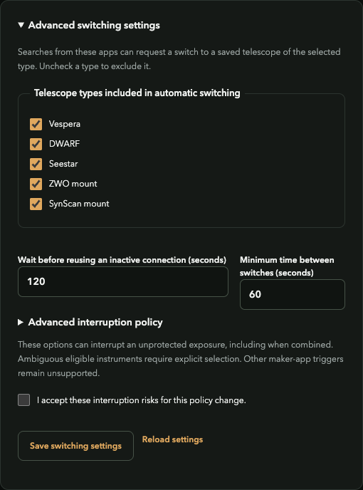
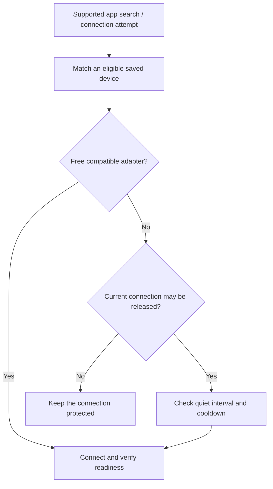

# Automatic switching and connection protection

[Documentation](../README.md) / Switching

Enable **Automatic telescope switching** on the home page. It reacts to supported app searches or connection attempts reaching Astro Bridge.

## How a request becomes a connection

Detection is separate from authentication. A bridge switch does not log the manufacturer's app into the instrument; the app may need another search after Wi-Fi association.

## What prevents replacement

| Protection | Meaning |
| --- | --- |
| Viewing or transfer activity | Recent observed traffic is incompatible with release |
| Unknown observation coverage | Absence of packets cannot establish inactivity |
| Reservation | A time-limited hold; renew before expiry |
| Owner lock | A persistent manual hold until explicitly removed |
| Reserved management adapter | A private-network/hotspot role cannot be taken |
| Quiet interval / cooldown | Minimum observed inactivity and spacing between replacements |

The home page shows the connected instrument and its protection. Information buttons explain the detail; advanced timing and interruption options are collapsed in Settings.

## Activity is not acquisition state

The collector observes bounded packet/byte/session metadata on owned forwarding paths. Reviewed family classifiers distinguish small control/background exchanges from probable content transfer. It does not inspect images or assert that an autonomous exposure has finished.

Use a reservation or owner lock when an instrument must remain connected despite little visible traffic. Mount plugins protect all observed traffic. New plugins cannot opt into another family's background exemptions.

Family-specific triggers and first-connection limits are in [Discovery mechanisms](../reference/discovery.md). Timing notices use previous observed switches; they are estimates, not deadlines.
