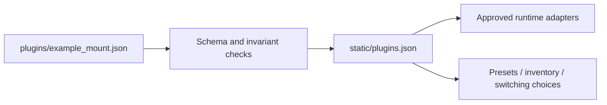

# Create a declarative hardware plugin

[Documentation](../README.md) / Plugins

A plugin describes a **protocol family**. A saved profile represents **one physical instrument** using that family. Plugins are reviewed JSON data, bundled with an application update; there is no runtime code-upload or plugin store.


## What a manifest can add

A descriptor using existing adapters can provide Wi-Fi recognition, a prefilled addition form, profile type, TCP/UDP relay, guarded app-demand switching, inventory details and automatic-policy choices. It cannot invent an unsupported discovery protocol or bypass connection protection.



## 1. Decide whether a new family is needed

- **Another model of an existing protocol:** extend that family's Wi-Fi hints, documented defaults and validation models.
- **New hardware using an existing transport/adapter:** add a manifest.
- **New identity/search protocol:** implement and review a bounded adapter first; then reference its identifier.

Read the manufacturer's protocol. Confirm addressing, exact transport/ports and a read-only identity operation. Do not infer these from a similar brand name.

## 2. Start from the example

```sh
cp examples/plugins/example_mount.json plugins/example_mount.json
```

The [complete example](../../examples/plugins/example_mount.json) is fictional and starts at `unverified`. Replace its prefix, address, ports and protocol URL with documented values.

```json
"wifi": [{"prefix": "Example_", "min_suffix": 1, "suffix": "alnum-hyphen-underscore"}],
"default_address": "192.168.5.1",
"relay": {"transport": "tcp", "ports": [12345]},
"identification": "none",
"discovery": {"engine": "tcp_syn", "target_mode": "proxy_or_original"},
"activity": "protect_all",
"readiness": "association"
```

Use a stable `id`; saved profiles and automatic policies depend on it. Do not rename or remove an installed family without a configuration migration.

## 3. Choose only implemented behavior

| Need | Choose |
| --- | --- |
| Recognize Wi-Fi and provide manual routed access | Wi-Fi hints, optional address, `relay: null`, discovery `none` |
| Forward native TCP | Exact TCP ports; `tcp_syn` demand if appropriate |
| Forward native UDP without supported search | UDP ports, discovery `none` |
| SynScan version search | `synscan_version`, UDP 11880, exact approved adapter contract |
| Identify ZWO-compatible models | `zwo_model` with its compatible single-port TCP transport |
| Unknown protocol | `identification: none`; add a reviewed adapter before advertising more |

All mount and new-family traffic uses **`protect_all`**. A manifest cannot claim that unknown traffic is a harmless keepalive.

## 4. Add defaults only when documented

```json
"onboarding": [
  {"prefix": "Example_", "target_ip": "192.168.5.1", "password": "documented-default"}
]
```

Only add a factory password if an upstream reference establishes it. It is a suggestion, never a stored user password. Longest matching prefix wins. Leave variable addresses unknown instead of guessing.

## 5. Generate and test

```sh
python3 tools/build-plugins.py
python3 scripts/generate_openapi.py
python3 -m unittest discover -s tests
node --test tests/*.test.mjs
python3 tools/build-plugins.py --check
```

Restart the demo to load the new bundle. Check **Settings → Plugins**, the scan assistant, preset fields and switching choices. Saved credentials and existing family IDs must remain intact.


## 6. Validate hardware and submit a PR

Follow the [hardware test sequence](../contributing/hardware-validation.md). Include the source manifest, generated catalog/schema/OpenAPI changes, sanitized fixtures, protocol links and a precise test matrix.

Use `unverified` before testing, `simulation` for synthetic/namespace evidence, and `partial_hardware` only for named devices with the checks actually performed. These labels do not mean every model or operation works.

Open a [hardware-support issue](https://github.com/Sqound/astro-bridge-core/issues/new?template=hardware-support.yml) or a [pull request](https://github.com/Sqound/astro-bridge-core/pulls). See the [field reference](manifest-reference.md) for limits and adapter invariants.
