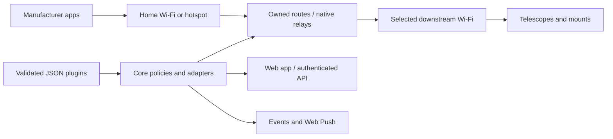

# Connection architecture

[Documentation](../README.md) / Architecture

## Core responsibilities

| Area | Implementation |
| --- | --- |
| Profiles and credentials | Validated persistent configuration; secrets omitted from normal API responses |
| Hardware catalog | Versioned source manifests bundled into `static/plugins.json` |
| Discovery and demand | Curated parsers, bounded probes and correlated replies |
| Switching | Adapter allocation, eligibility, reservations/locks, quiet windows and cooldown |
| Activity | Owned nftables counters and conntrack observations; no image inspection |
| Management | Cookie/CSRF browser API, transport-bound Bearer API and optional HTTPS |

The `wifi_bridge` import and configuration paths are retained for compatibility. The package distribution and console command are `astro-bridge-core` and `astro-bridge`.

## Platform responsibilities

[Implementations](https://github.com/Sqound/astro-bridge-implementations) supply Python, Wi-Fi drivers, NetworkManager, AP/DHCP services, persistent storage, networking permissions, certificate helper, crypto runtime and update/recovery lifecycle. They pin an exact core artifact by checksum instead of maintaining an application fork.

The core includes a shared optional Linux backend and a separate `DemoNetwork`. Demo mode simulates operations and cannot validate physical radio behavior. Other Unix platforms can run the demo; real networking currently targets Linux.

## Boundaries

- An SSID is a candidate hint, not authenticated hardware identity.
- A connection demand is a selection signal, not an app login.
- Routing/service readiness is not proof of camera/control success.
- Activity silence is not proof that autonomous acquisition ended.
- A manifest chooses approved behavior; it cannot execute scripts or firewall fragments.
